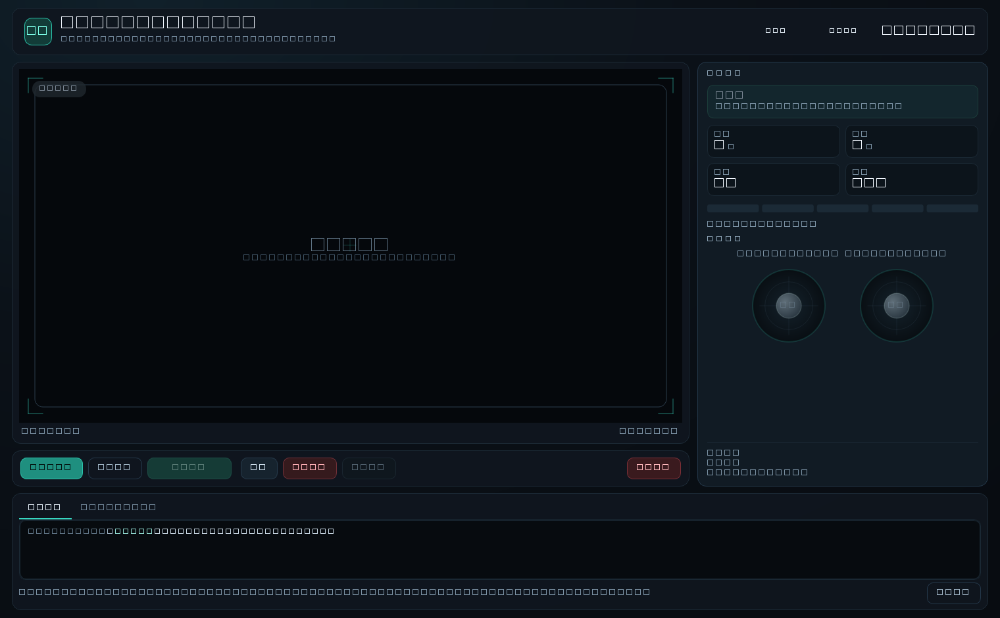

# 空地协同 · 无人机地面站 v0.2

基于 APEX G149 / GD240 协议实现的 Windows 桌面地面站。v0.2 默认**只读**：连接后只接收视频和遥测，不发送飞行控制帧；点击“接管控制”并**人工确认控制权**后，才允许解锁、一键起飞和摇杆操作。



> 真机控制相关测试必须在**卸桨、固定机身**的状态下进行。

## v0.2 主要变化

- `status=1` 只表示飞控收到控制帧，不代表控制权；接管后弹出人工确认对话框。
- 新增“解锁电机/加锁电机”切换按钮（App 组合，`bit7` 反馈，失败重试一次）。
- 一键起飞联锁：`bit7=False` 时禁止。
- 断开、交还控制、关闭前，如已确认控制且地面解锁，先加锁；失败会阻止并提示断电。
- 断链停桨约 10 秒；程序不依赖该延迟。
- 修正左右杆上下方向；键盘长按持续控制（自动重复按键不再误触发松手）。
- 低电策略改为**仅告警**：电池临界时不再自动锁定飞行控制，飞行员可继续操控并降落；落地后才禁止起飞。
- 照片和录像右上角烧录本地时间戳（`YYYY-MM-DD HH:MM:SS`），可在界面开关；录像制作期间不可修改。
- 预览左上角新增紧凑 `● REC HH:MM:SS` 指示，红点轻微闪烁；底栏显示录制状态（录制中/关闭），精确时长只在预览徽标中显示；仅界面显示，不烧录进视频。
- 新增“放大日志/诊断”按钮，可扩大底部区域，也可拖动分隔条。

## 开发与交接文档

- `AGENTS.md`：智能体/开发者操作守则、禁止事项、验证标准
- `docs/ARCHITECTURE.md`：模块职责、数据流、线程模型、状态机、安全不变量
- `docs/DEBUGGING.md`：症状 → 模块 → 日志 → 调用链的排障索引
- `CHANGELOG.md`：版本变化
- `requirements.lock.txt`：已验证的精确依赖版本

## 已实现

- Wi-Fi 无人机热点下的 TCP `192.168.1.1:3333` 控制链路。
- CTP 协议：`APP_ACCESS`、`DATE_TIME`、`CTP_KEEP_ALIVE`、`GENERIC_CMD`、`OPEN_RT_STREAM` / `CLOSE_RT_STREAM`。
- 14 字节控制帧、校验和、40 Hz 发送、100–125 ms 动作脉冲。
- 遥测 V2 解码：高度、电压、`D10`、`flags`、`fly`、拍照/录像位、`bit7`。
- UDP `2224` 视频：20 字节 JL 分片头、多分片重组、H.264 Annex-B、PyAV 解码、25 fps 预览。
- 断链重连（20 s 窗口，超时后停止重试并等待手动重连）、视频重逢、解码器重置、等待 SPS/PPS + IDR。
- 默认只读：连接后不发送任何 `GENERIC_CMD` 控制帧，遥控器仍可控制。
- 接管门控：点击“接管控制”后才发送控制帧；等待飞控 `status=1` 确认，超时弹出“接管未确认”。
- 一键起飞/降落脉冲、双摇杆、键盘摇杆（WASD + 方向键）、拍照、MP4 录制、紧急停桨。
- 本地存储目录可选并持久化：照片/录像写入所选目录的日期子文件夹。
- 时间戳水印：照片/录像右上角本地时间，白字黑描边；设置持久化，默认开启。
- 安全状态机：断链 1 s 告警、约 5 s 自动缓降提示、重连不自动恢复控制；低电池临界仅告警、不锁定飞行控制，落地后低电锁定。
- 诊断页：原始 16 字节遥测、`bit7`、飞控 flags、UDP 包/丢帧/解码失败、码率、fps、接管状态。

## 运行

### 1. 安装依赖

```powershell
cd D:\default_agent_work\uav_gcs
python -m pip install -r requirements.txt
```

如需复现已验证的依赖版本（排障/交接推荐）：

```powershell
python -m pip install -r requirements.lock.txt
```

如果 PySide6 下载慢，可只安装 Essentials：

```powershell
python -m pip install -i https://pypi.tuna.tsinghua.edu.cn/simple PySide6-Essentials
```

### 2. 连接无人机热点

程序不负责切换 Windows Wi-Fi。请先在系统 Wi-Fi 中连接无人机热点（示例：`Tspeed7-9253f084`，无密码），确认本机拿到 `192.168.1.x` 地址。

### 3. 启动

```powershell
python main.py
```

或双击 `run.bat`。

### 4. 本地自检

```powershell
python -m unittest discover -s tests -v
```

当前共 29 个用例，覆盖 CTP 编解码、遥测解码、控制帧校验、视频分片重组、断链/低电安全状态、控制帧默认禁用、存储目录、时间戳水印、设置持久化、录像文件命名唯一性。

### 5. 连接前说明

点击“连接无人机”后弹出一项只读说明确认：

- 连接后默认只读，不发送控制帧；
- 遥控器可以随时控制；
- 点击“接管控制”后才会尝试控制，接管可能锁住遥控器且不保证成功；
- 连接期间官方 App 无法同时连接无人机 Wi-Fi；
- 首次测试/真机使用建议卸桨、固定机身并保留遥控器作为独立处置手段。

勾选“我已知晓以上说明”后即可连接。

## 操作

- **连接无人机**：建立 TCP，接收遥测，自动请求视频流；默认只读。
- **取消连接 / 断开连接**：连接中可随时取消；断开后立即停止重连，可再次连接。
- **重新连接**：20 秒内未能连接时自动停止重试，按钮变为“重新连接”，由你手动重试。
- **未连接热点**：程序会先检查当前 WLAN 的 SSID；未连接无人机热点时直接提示“未连接热点”，不会反复重试。
- **接管控制**：点击后才开始发送控制帧；程序等待飞控 `status=1`。收到后弹出“确认控制权”对话框：请用遥控器尝试控制，遥控器仍能控制则接管失败并交还；不能控制才确认接管。
- **解锁电机 / 加锁电机**：接管人工确认后可用；使用 App 组合 `(45,36,39,212)`，根据 `bit7` 显示状态；失败自动重试一次。仅地面、未飞行时可用，飞行中禁止加锁。
- **一键起飞 / 一键降落**：同一个 D8 bit3 脉冲，按 `fly` 和高度切换按钮含义；必须先解除锁定（`bit7=True`）才允许一键起飞。
- **左摇杆**：上下=油门（上=上升），左右=偏航。
- **右摇杆**：上下=前后（上=前进），左右=左右平移。松手自动回中。
- **键盘摇杆**：勾选“启用键盘摇杆”后，W/S 油门、A/D 偏航；方向键 ↑/↓ 前后、←/→ 平移。需先接管并进入飞行状态；长按持续生效；窗口失焦自动回中。接管确认且电机解锁后会自动勾选；手动取消后本次解锁周期不再自动打开；落地、加锁或交还控制时自动关闭。
- **拍照**：保存当前解码帧为 JPEG 到当前存储目录；时间戳水印开启时烧录到右上角。
- **开始录制**：把解码帧编码为本地 H.264 MP4；不依赖无人机 SD 卡。预览左上角显示 `● REC HH:MM:SS`，底栏显示“本地录制：录制中（点击停止）”，仅界面显示，不写入视频；录像右上角按水印设置烧录时间戳。
- **时间戳水印**：勾选后照片和录像右上角烧录本地时间；设置会记住；录制中复选框置灰并显示“已锁定”提示。
- **存储目录…**：选择照片/录像的本地存储目录，立即生效并记住；录像中不允许切换。
- **重开视频**：发送 `CLOSE_RT_STREAM` 后重新 `OPEN_RT_STREAM`，并重置解码器。用于预览卡死、花屏或视频中断但链路仍正常时；不会重连控制链路，录制中点击可能造成短暂丢帧。
- **紧急停桨**：发送 D3 紧急位，需二次确认；该位尚未在真机验证。
- **放大日志/诊断**：扩大底部日志/诊断区域；也可拖动分隔条调整高度。

## 安全策略（当前版本）

- 默认只读：连接后不发送任何控制帧；遥控器可正常控制。
- 接管：点击“接管控制”后才开始发送控制帧；等待飞控 `status=1`。
  - 收到 `status=1`：只表示飞控收到控制帧，不表示控制权；弹出人工确认对话框。
  - 人工确认成功：状态显示“已接管 · 已确认”；遥控器仍能控制则必须交还。
  - 交还控制：停止控制帧，地面解锁时先加锁，再断开 TCP 并以只读模式重连；不要在空中随意操作。
- 解锁/加锁：App 组合切换，`bit7` 反馈；仅地面可用；断开/交还/退出前尝试主动加锁，失败会阻止并提示断电。
- 断链停桨：实测解锁后直接断开 TCP，电机约 10 秒后停止；程序不依赖该延迟。
- 低电：**仅告警**，不主动发自动降落指令，也不因“低电 + 小幅下降”锁定飞行控制；飞行员可继续操控并降落。电池临界时禁止起飞。
- 断链：1 s 无遥测告警；约 5 s 视为飞控可能已自动缓降。之前实测约 3 s，因此 3 s 就提示“可能已开始”。
- 重连：不自动恢复控制，不自动恢复摇杆；必须重新观察并显式接管。
- 自动缓降（断链）：锁定起飞/降落/摇杆，避免和飞控状态竞争；不要在此期间反复发一键降落脉冲。
- 低电落地：确认落地后进入 `LANDED_LOCKOUT`，禁止起飞；需更换电池或点击“已更换电池 / 解除低电锁定”。
- `bit7`：已确认可表示电机解锁/加锁状态；`False=已锁定`，`True=已解锁/电机可能转动`。
- 连接冲突启发式：如果连接在 2 s 内被反复重置 3 次，程序会标记“可能的另一控制端/链路冲突”；确认另一控制端关闭后可点“清除连接冲突标记”。

## 配置

`config/safety_profile.json` 可调整：

- `firmware.link_loss_expected_delay_s`：断链后预计自动缓降时间，默认 5.0 s。
- `firmware.link_loss_early_warning_s`：提前提示时间，默认 3.0 s。
- `link.telemetry_timeout_ms`：遥测超时，默认 1000 ms。
- `link.connect_total_timeout_ms`：首次连接/断链重连的总窗口，默认 20000 ms；超时后停止重试。
- `link.drone_ssid_prefixes`：判定“已连接无人机热点”的 SSID 前缀，默认 `["Tspeed7", "Tspeed", "AT66"]`。如果 WLAN 状态无法读取，则退回检查本机是否有 `192.168.1.x` 地址。
- `battery.*`：电压/`D10` 预警和禁飞阈值。
- `coexistence.require_exclusive`：当前仅作历史配置保留，程序默认只读，不再强制独占。

接管确认超时可在 `app/config.py` 的 `TAKEOVER_ACK_TIMEOUT_S` 调整，默认 2.0 s。

## 本地文件

默认存储目录是 `recordings/`，可在程序里点击“存储目录…”修改；配置保存在 `config/ui_settings.json`。

- 照片：`<所选目录>/YYYY-MM-DD/snap_*.jpg`
- 录像：`<所选目录>/YYYY-MM-DD/rec_YYYYMMDD_HHMMSS_mmm.mp4`（毫秒时间戳；2 GB 分段追加 `_partN`；同名时自动追加 `_2`，不会覆盖已有录像）
- 索引：`media.db`（仍在程序根目录）
- 日志：程序界面“运行日志”页

录像使用 PyAV + libx264 编码为 MP4；如果编码失败，界面会记录错误、自动停止录制并恢复按钮状态。磁盘低于 1 GB 时拒绝开始录制，低于 5 GB 时提示。

时间戳水印在保存前绘制：照片直接写入 JPEG；录像在编码每一帧前绘制，因此播放和转发后的文件同样保留时间。预览画面本身不绘制水印。时间戳开关保存在 `config/ui_settings.json`，默认开启。

## 已知限制 / 未实测项

- 接管是否真正取得控制权取决于无人机仲裁；`status=1` 作为确认信号的语义仍需实验验证。
- 如果遥控器已在控制，程序不保证能抢过控制权；接管提示只表示“收到/未收到飞控确认”。
- 未在真实无人机上验证紧急停桨。
- 一键起飞/降落、轴方向、落地自动加锁已在 C4b 实飞验证；空中接管（C4d）仍未测试。
- 低电池自动缓降的触发阈值和延迟未知；当前版本对低电只告警，不跟踪缓降。
- App / 程序不能同时直连：无人机热点只允许 1 个 Wi-Fi 客户端；程序连接期间官方 App 无法入网。
- 录像为解码后重编码，不是无人机原始码流封装；会增加 CPU 占用。
- 视频端口 `2224` 被占用时，程序会记录错误并重试监听。
- 程序不会自动关闭 Windows 防火墙或切换 Wi-Fi。

## 安全提示

- 控制测试必须卸桨。
- 首次飞行前，先在台架确认接管提示、起飞/降落、摇杆方向和紧急停桨行为。
- 接管前先确认遥控器状态；接管超时提示出现时，先用遥控器复核再继续操作。

- 飞行时使用开阔场地、桨叶防护、独立观察员，并保留遥控器/断电作为独立处置手段。
